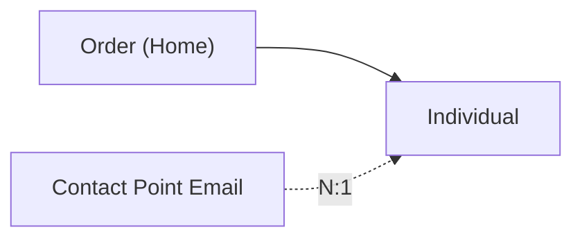

# data360-autodoc

[](https://pypi.org/project/data360-autodoc/)
[](https://pypi.org/project/data360-autodoc/)
[](https://github.com/valentinatihova/data360-autodoc/actions/workflows/tests.yml)
[](LICENSE)

**Auto-generate human-readable documentation for Salesforce Data 360 (Data Cloud) orgs — in seconds, not days.**

Point it at an org and it produces a full data dictionary (DMOs, DLOs, fields, keys), the data streams and field-level mappings behind them, the DMO relationship graph, an ERD, and a deterministic JSON snapshot.

- 📓 **Data dictionary** — every DMO and DLO as clean Markdown tables, with field names, types, and keys.
- 🌊 **Data streams + field mappings** — per-stream source/refresh metadata, the Stream → DLO field map, and the DLO → DMO field map (with real labels, not just API names).
- 🔗 **Relationships + ERD** — DMO-to-DMO relationships with cardinality and status, plus a Mermaid graph of DLO → DMO mappings and relationship edges.
- 🧊 **JSON snapshot** — a deterministic, diff-friendly export of your whole org schema.
- 🚨 **Drift detection** — `data360-autodoc diff` compares two snapshots and reports exactly what changed (DMOs, DLOs, fields, mappings, relationships) as Markdown or JSON, with a `--fail-on-change` exit code for CI — see [Drift detection](#drift-detection).

## For who

Built for **Salesforce SI consultants and Data Cloud practitioners** who lose days hand-writing org documentation for every engagement. It works against any Data 360 org you can authenticate to with a connected app, and is **tested against Developer Edition / Data Cloud dev orgs** — try it on a sandbox before pointing it at a client. If your org has a shape it doesn't handle yet, [open an issue](https://github.com/valentinatihova/data360-autodoc/issues) and it gets fixed.

## Quick start

```bash
pip install data360-autodoc

data360-autodoc generate \
  --instance-url https://mydomain.my.salesforce.com \
  --client-id <connected-app-consumer-key> \
  --private-key ./server.pem \
  --username admin@myorg.com \
  --output ./docs \
  --format all
```

```
Wrote acme-data-cloud.md
Wrote acme-data-cloud.mmd
Wrote acme-data-cloud.json
Generated docs for 24 DMOs, 11 DLOs, 0 Identity Rulesets
```

Authentication uses the **OAuth 2.0 JWT Bearer flow** (connected app + private key — no passwords stored).

**Options that affect the metadata fetch:**

- `--sandbox` — authenticate against `test.salesforce.com` (sandbox / scratch orgs).
- `--api-version` — the Salesforce REST API version used for the `/ssot/*` metadata calls (e.g. `v62.0`). **By default the tool auto-detects your org's highest supported version** (from `GET /services/data/`), so you normally don't set this. Force it only if auto-detection picks a version where a Data Cloud endpoint misbehaves, or to pin output to a specific version. It must be a valid Salesforce REST API version your org supports.

(The `Identity Rulesets` count is currently always `0` — see "Not supported yet" below.)

## What you get

`--format` controls the output:

| Format | Files | What it is |
|--------|-------|------------|
| `markdown` | `.md` + `.mmd` | Data dictionary + Mermaid ERD |
| `json` | `.json` | Deterministic org-schema snapshot |
| `pdf` | — | _Coming soon_ |
| `all` | all of the above | Everything |

### Example output

The Markdown data dictionary. DMO field types come from the org's relationships metadata, and fall back to the mapped DLO field type when the DMO endpoint returns a generic type (shown as `(via DLO)`); DLO keys come from the data streams:

```markdown
## Data Model Objects (DMOs)

### Individual (`Individual__dmo`)

| Name | Type | Key |
| --- | --- | --- |
| Email__c | EmailAddress |  |
| Id__c | Text |  |

## Data Lake Objects (DLOs)

### Order (Home) (`Order_Home__dll`)

| Name | Type | Key |
| --- | --- | --- |
| Amount | Number |  |
| OrderId | Text | PrimaryKey |
```

Beyond the dictionary, the document includes (in this order):

- **Data Streams** — one row per stream: data source, category, primary key, schedule, refresh mode.
- **Field Mapping (Streams → DLO)** — every Data Lake field with its source field, DLO label, type, and a `KQ_`-prefix foreign-key flag.
- **DLO → DMO Field Mappings** — field-level source → target mappings, grouped by DLO → DMO pairing, with real labels joined from DLO metadata.
- **Relationships** — DMO-to-DMO links with cardinality and status (inactive standard relationships stay visible, never dropped):

```markdown
## Relationships

| Object | Field | Cardinality | Related Object | Related Field | Status |
| --- | --- | --- | --- | --- | --- |
| Account | ssot__PrimarySalesContactPointId__c | N:1 | ssot__ContactPointEmail__dlm | ssot__Id__c | INACTIVE |
```

The ERD (renders natively in GitHub). Solid arrows are DLO → DMO mappings; dashed, cardinality-labeled arrows are active DMO → DMO relationships:



Output is **deterministic** — the same org always produces byte-identical docs (collections are sorted alphabetically). That makes the output safe to commit and easy to diff.

### What it reads — and what it doesn't yet

Under the hood it calls the **Data 360 Connect REST API** (`/services/data/v…/ssot/*`): `data-model-objects` (DMOs), `data-model-object-mappings` (DLO→DMO mappings + field names), `…/{dmo}/relationships` (DMO field types **and** the DMO-to-DMO relationship graph), and `data-streams` (DLOs + their fields + the per-stream and field-level mappings, including primary keys). Full request/response shapes are in [`agent_docs/api_reference.md`](agent_docs/api_reference.md).

**Not supported yet.** Calculated Insights and Identity Resolution rulesets are **not fetched** — those sections render as empty placeholders (e.g. `_No Calculated Insights found._`) and the `Identity Rulesets` count stays `0`. Documenting them is on the roadmap. (Profile and Engagement DMOs *are* covered — those are DMO categories, not separate entities.)

**Resilient by default.** If one DMO's metadata can't be read, that DMO is skipped with a warning and the rest of the document is still produced. If the org has more than 500 DMOs, the list is capped (with a warning). A failure fetching the DMO list or the data streams stops the run with a clean one-line error — never a stack trace.

## Drift detection

An org documented today is stale next week: a client admin adds a DLO, retypes a field, re-points a mapping, deactivates a relationship. Save a JSON snapshot, take another one later (or from another org — sandbox vs production), and `diff` tells you exactly what changed:

```bash
data360-autodoc diff snapshots/acme-before.json snapshots/acme-after.json
```

No org credentials needed — `diff` only reads the two snapshot files. Try it on the synthetic snapshots in [`tests/fixtures/`](tests/fixtures/):

```markdown
# Data 360 Schema Drift — Acme Data Cloud

_Old: 2026-10-01 06:00:00 UTC · https://acme.my.salesforce.com_
_New: 2026-10-08 06:00:00 UTC · https://acme.my.salesforce.com_

**18 changes detected.**

| Area | Added | Removed | Changed |
| --- | --- | --- | --- |
| DMOs | 1 | 0 | 2 |
| DMO fields | 2 | 0 | 1 |
| DLOs | 1 | 1 | 2 |
| DLO fields | 2 | 0 | 1 |
| DLO → DMO object mappings | 1 | 1 | — |
| DLO → DMO field mappings | 4 | 1 | — |
| Relationships | 1 | 0 | 1 |

## Data Model Objects (DMOs)

### Added

- Account (`ssot__Account__dlm`) — 2 fields

### Changed

#### Sales Order (`ssot__SalesOrder__dlm`)

| Change | Field | Details |
| --- | --- | --- |
| added | ssot__AccountId__c | Text |
| changed | ssot__TotalAmount__c | type: Text → Number |

…

## Relationships

| Change | Object | Field | Related Object | Related Field | Details |
| --- | --- | --- | --- | --- | --- |
| added | ssot__SalesOrder__dlm | ssot__AccountId__c | ssot__Account__dlm | ssot__Id__c | N:1, ACTIVE |
| changed | ssot__ContactPointEmail__dlm | ssot__PartyId__c | ssot__Individual__dlm | ssot__Id__c | status: ACTIVE → INACTIVE |
```

**What is compared:**

| Area | Identified by | Reported |
| --- | --- | --- |
| DMOs, DLOs | API name | added / removed; label changes |
| Fields | object + field name | added / removed; `type`, `is_key`, `key_qualifier` changes |
| DLO → DMO object mappings | source DLO + target DMO | added / removed |
| DLO → DMO field mappings | source DLO + field → target DMO + field | added / removed (a re-pointed field shows as one of each) |
| DMO relationships | object + field → related object + field | added / removed; `cardinality`, `status`, label changes |

The snapshot timestamp, display labels on mapping rows, and the `(via DLO)` type-provenance flag are ignored — they are not schema changes.

**Options:**

- `--format markdown|json` — human-readable report (default) or a machine-readable JSON report (`has_changes`, `change_count`, per-area `summary`, and full added/removed/changed detail) for scripts.
- `--output FILE` — write the report to a file instead of stdout. A one-line summary (`Schema drift: 18 changes` / `No schema drift.`) always goes to stderr, so piped stdout stays a clean report.
- `--fail-on-change` — exit with status `1` when anything drifted. Without it, `diff` exits `0` whether or not drift was found. An unreadable or incompatible snapshot exits `2`.

### Drift checks in CI

[`examples/github-actions/data360-drift.yml`](examples/github-actions/data360-drift.yml) is a ready-to-copy GitHub Actions workflow: on a weekly schedule it fetches a fresh snapshot with JWT auth from repository secrets, diffs it against a baseline committed to the repo, writes the drift report to the job summary, uploads the new snapshot as an artifact, and fails the run when the schema drifted. The core of it:

```bash
data360-autodoc generate ... --format json --output current
data360-autodoc diff snapshots/acme-data-cloud.json current/acme-data-cloud.json \
  --output drift/drift.md --fail-on-change
```

To accept a change, replace the baseline with the new snapshot and commit it.

## License

MIT
