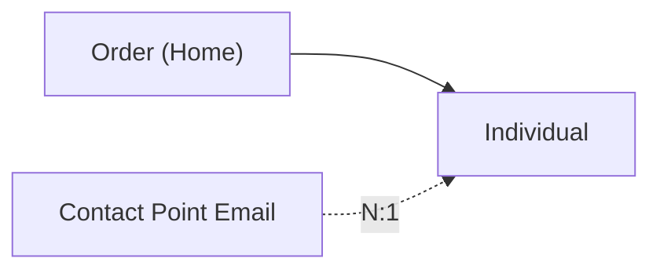

# data360-autodoc

[](https://pypi.org/project/data360-autodoc/)
[](https://pypi.org/project/data360-autodoc/)
[](https://github.com/valentinatihova/data360-autodoc/actions/workflows/tests.yml)
[](LICENSE)

**Auto-generate human-readable documentation for Salesforce Data 360 (Data Cloud) orgs — in minutes, not days.**

Point it at an org and it produces a full data dictionary (DMOs, DLOs, fields, keys), the data streams and field-level mappings behind them, the DMO relationship graph, an ERD, and a deterministic JSON snapshot.

## See the result first


*A real run against a Developer Edition org. The ~2.5-minute wait while it lists about a thousand standard DMOs is sped up 30×.*

[](https://github.com/valentinatihova/data360-autodoc/blob/main/examples/sample-report/acme-data-cloud-developer-edition.md)

This is real output from a Salesforce **Developer Edition** org (the standard data model and its built-in CRM data streams, no customer data; host name redacted): 22 DMOs, 17 DLOs, 26 mappings. Browse the full sample:

- 📓 [Data dictionary (Markdown)](https://github.com/valentinatihova/data360-autodoc/blob/main/examples/sample-report/acme-data-cloud-developer-edition.md)
- 🔗 [DLO → DMO graph (Mermaid)](https://github.com/valentinatihova/data360-autodoc/blob/main/examples/sample-report/acme-data-cloud-developer-edition.mmd)
- 🧊 [JSON snapshot (input for `diff`)](https://github.com/valentinatihova/data360-autodoc/blob/main/examples/sample-report/acme-data-cloud-developer-edition.json)

What it covers:

- 📓 **Data dictionary** — every DMO and DLO as clean Markdown tables, with field names, types, and keys.
- 🌊 **Data streams + field mappings** — per-stream source/refresh metadata, the Stream → DLO field map, and the DLO → DMO field map (with real labels, not just API names).
- 🔗 **Relationships + ERD** — DMO-to-DMO relationships with cardinality and status, plus a Mermaid graph of DLO → DMO mappings and relationship edges.
- 🧊 **JSON snapshot** — a deterministic, diff-friendly export of your whole org schema.
- 🚨 **Drift detection** — `data360-autodoc diff` compares two snapshots and reports exactly what changed (DMOs, DLOs, fields, mappings, relationships) as Markdown or JSON, with a `--fail-on-change` exit code for CI — see [Drift detection](#drift-detection).

## For who

Built for **Salesforce SI consultants and Data Cloud practitioners** who lose days hand-writing org documentation for every engagement. It works against any Data 360 org you can log into with the Salesforce CLI (or a connected app), and is **tested against Developer Edition / Data Cloud dev orgs** — try it on a sandbox before pointing it at a client. If your org has a shape it doesn't handle yet, [open an issue](https://github.com/valentinatihova/data360-autodoc/issues) and it gets fixed.

## Quick start

Needs Python 3.11+. `pipx` (or `uvx`) installs it in its own environment, so an older system Python doesn't get in the way:

```bash
pipx install data360-autodoc        # or: uvx data360-autodoc ..., or: pip install data360-autodoc
pipx ensurepath                     # first pipx install only: puts the command on PATH (open a new terminal after)

sf org login web --alias my-org     # once: reuse your Salesforce CLI login, no connected app needed
data360-autodoc generate --target-org my-org --output ./docs
```

```
Using API version v68.0
  Listing DMOs… 1046 scanned
Found 22 DMO(s); fetching metadata…
Fetching data streams…
Wrote my-org.md
Wrote my-org.mmd
Wrote my-org.json
Generated docs for 22 DMOs, 17 DLOs, 0 Identity Rulesets
```

A new org lists about a thousand standard DMOs, so the first step takes a few minutes; the counter shows progress.

**Ways to sign in** (use exactly one):

| Mode | Flags | Environment variables |
|------|-------|-----------------------|
| Salesforce CLI session (easiest) | `--target-org ALIAS` | `DATA360_TARGET_ORG` |
| Access token | `--instance-url URL --access-token TOKEN` | `DATA360_INSTANCE_URL`, `DATA360_ACCESS_TOKEN` |
| JWT bearer (CI, connected app + private key) | `--instance-url URL --client-id KEY --private-key server.pem --username USER` | `DATA360_INSTANCE_URL`, `DATA360_CLIENT_ID`, `DATA360_PRIVATE_KEY`, `DATA360_USERNAME` |

Environment variables are read only when no sign-in flag is given, and keep tokens out of the process list. If the session has expired, you get a one-line hint (for `--target-org`: run `sf org login web --alias ALIAS` again) instead of empty docs.

**Other options:**

- `--org-name "Acme Prod"` — document title and output file name (default: the alias with `--target-org`, otherwise the org's host name).
- `--diagram-image svg|png` — also draw the Mermaid diagram as an image, for Confluence and other tools that don't render Mermaid. Needs [mermaid-cli](https://github.com/mermaid-js/mermaid-cli) (`npm install --global @mermaid-js/mermaid-cli`); without it you get a warning and the rest of the docs as usual.
- `--sandbox` — JWT auth against `test.salesforce.com` (sandbox / scratch orgs).
- `--all-dmos` — document every DMO. By default only the DMOs your org uses are documented: **enabled** standard DMOs plus all **custom** DMOs. A new org lists about a thousand disabled standard DMOs, which would only add empty tables. The choice is recorded in the JSON snapshot, and `diff` warns if two snapshots used different settings.
- `--api-version` — the Salesforce REST API version used for the `/ssot/*` metadata calls (e.g. `v62.0`). **By default the tool auto-detects your org's highest supported version** (from `GET /services/data/`), so you normally don't set this. Force it only if auto-detection picks a version where a Data Cloud endpoint misbehaves, or to pin output to a specific version. It must be a valid Salesforce REST API version your org supports.
- `--strict` — fail (and write nothing) if any DMO can't be read, instead of writing a partial snapshot. Use it in CI before `diff`.
- `--verbose` — errors are short by default (no host name or API response body, safe on a shared screen); this shows the full detail.

(The `Identity Rulesets` count is currently always `0` — see "Not supported yet" below.)

## What you get

`--format` controls the output:

| Format | Files | What it is |
|--------|-------|------------|
| `markdown` | `.md` + `.mmd` | Data dictionary + Mermaid ERD |
| `json` | `.json` | Deterministic org-schema snapshot |
| `pdf` | — | _Coming soon_ |
| `all` | `.md` + `.mmd` + `.json` | Everything available (PDF is not part of it yet) |

### Example output

The Markdown data dictionary. DMO field types come from the org's relationships metadata, and fall back to the mapped DLO field type when the DMO endpoint returns a generic type (shown as `(via DLO)`); DLO keys come from the data streams:

```markdown
## Data Model Objects (DMOs)

### Individual (`Individual__dmo`)

| Name | Type | Key |
| --- | --- | --- |
| Email__c | EmailAddress |  |
| Id__c | Text |  |

## Data Lake Objects (DLOs)

### Order (Home) (`Order_Home__dll`)

| Name | Type | Key |
| --- | --- | --- |
| Amount | Number |  |
| OrderId | Text | PrimaryKey |
```

Beyond the dictionary, the document includes (in this order):

- **Data Streams** — one row per stream: data source, category, primary key, schedule, refresh mode.
- **Field Mapping (Streams → DLO)** — every Data Lake field with its source field, DLO label, type, and a `KQ_`-prefix foreign-key flag.
- **DLO → DMO Field Mappings** — field-level source → target mappings, grouped by DLO → DMO pairing, with real labels joined from DLO metadata.
- **Relationships** — DMO-to-DMO links with cardinality and status (inactive standard relationships stay visible, never dropped):

```markdown
## Relationships

| Object | Field | Cardinality | Related Object | Related Field | Status |
| --- | --- | --- | --- | --- | --- |
| Account | ssot__PrimarySalesContactPointId__c | N:1 | ssot__ContactPointEmail__dlm | ssot__Id__c | INACTIVE |
```

The ERD (renders natively in GitHub). Solid arrows are DLO → DMO mappings; dashed, cardinality-labeled arrows are active DMO → DMO relationships:



Output is **deterministic** — the same org always produces byte-identical docs (collections are sorted alphabetically). That makes the output safe to commit and easy to diff.

### What it reads — and what it doesn't yet

Under the hood it calls the **Data 360 Connect REST API** (`/services/data/v…/ssot/*`): `data-model-objects` (DMOs), `data-model-object-mappings` (DLO→DMO mappings + field names), `…/{dmo}/relationships` (DMO field types **and** the DMO-to-DMO relationship graph), and `data-streams` (DLOs + their fields + the per-stream and field-level mappings, including primary keys). Full request/response shapes are in [`agent_docs/api_reference.md`](agent_docs/api_reference.md).

**Not supported yet.** Calculated Insights and Identity Resolution rulesets are **not fetched** — those sections render as empty placeholders (e.g. `_No Calculated Insights found._`) and the `Identity Rulesets` count stays `0`. Documenting them is on the roadmap. (Profile and Engagement DMOs *are* covered — those are DMO categories, not separate entities.)

**Resilient by default.** If one DMO's metadata can't be read, that DMO is skipped with a warning and the rest of the document is still produced. If more than 500 DMOs match, the list is capped (with a warning). A DMO with no relationships or no DLO mappings is documented with empty sections, not skipped. A failure fetching the DMO list or the data streams stops the run with a clean one-line error — never a stack trace.

## Drift detection

An org documented today is stale next week: a client admin adds a DLO, retypes a field, re-points a mapping, deactivates a relationship. Save a JSON snapshot, take another one later (or from another org — sandbox vs production), and `diff` tells you exactly what changed:

```bash
data360-autodoc diff snapshots/acme-before.json snapshots/acme-after.json
```

No org credentials needed — `diff` only reads the two snapshot files. Try it on the synthetic snapshots in [`tests/fixtures/`](tests/fixtures/):

```markdown
# Data 360 Schema Drift — Acme Data Cloud

_Old: 2026-10-01 06:00:00 UTC · https://acme.my.salesforce.com_
_New: 2026-10-08 06:00:00 UTC · https://acme.my.salesforce.com_

**18 changes detected.**

| Area | Added | Removed | Changed |
| --- | --- | --- | --- |
| DMOs | 1 | 0 | 2 |
| DMO fields | 2 | 0 | 1 |
| DLOs | 1 | 1 | 2 |
| DLO fields | 2 | 0 | 1 |
| DLO → DMO object mappings | 1 | 1 | — |
| DLO → DMO field mappings | 4 | 1 | — |
| Relationships | 1 | 0 | 1 |

## Data Model Objects (DMOs)

### Added

- Account (`ssot__Account__dlm`) — 2 fields

### Changed

#### Sales Order (`ssot__SalesOrder__dlm`)

| Change | Field | Details |
| --- | --- | --- |
| added | ssot__AccountId__c | Text |
| changed | ssot__TotalAmount__c | type: Text → Number |

…

## Relationships

| Change | Object | Field | Related Object | Related Field | Details |
| --- | --- | --- | --- | --- | --- |
| added | ssot__SalesOrder__dlm | ssot__AccountId__c | ssot__Account__dlm | ssot__Id__c | N:1, ACTIVE |
| changed | ssot__ContactPointEmail__dlm | ssot__PartyId__c | ssot__Individual__dlm | ssot__Id__c | status: ACTIVE → INACTIVE |
```

**What is compared:**

| Area | Identified by | Reported |
| --- | --- | --- |
| DMOs, DLOs | API name | added / removed; label changes |
| Fields | object + field name | added / removed; `type`, `is_key`, `key_qualifier` changes |
| Data streams | stream name | added / removed; target DLO, source, category, primary keys, formula fields, schedule, refresh / extraction mode changes |
| Stream → DLO field mappings | stream + DLO field | added / removed; source field, data type, primary / foreign key and nullability changes |
| DLO → DMO object mappings | source DLO + target DMO | added / removed |
| DLO → DMO field mappings | source DLO + field → target DMO + field | added / removed (a re-pointed field shows as one of each) |
| DMO relationships | object + field → related object + field | added / removed; `cardinality`, `status`, label changes |

The snapshot timestamp, display labels on mapping and stream rows, and the `(via DLO)` type-provenance flag are ignored — they are not schema changes. A missing value and an empty string count as the same value.

**Options:**

- `--format markdown|json` — human-readable report (default) or a machine-readable JSON report (`has_changes`, `change_count`, per-area `summary`, and full added/removed/changed detail) for scripts.
- `--output FILE` — write the report to a file instead of stdout. A one-line summary (`Schema drift: 18 changes` / `No schema drift.`) always goes to stderr, so piped stdout stays a clean report.
- `--fail-on-change` — exit with status `1` when anything drifted. Without it, `diff` exits `0` whether or not drift was found. Any error (an unreadable, malformed or incompatible snapshot, or a report that can't be written) exits `2`, so it is never mistaken for drift.

### Run drift checks in CI

Commit a baseline snapshot, then let CI take a fresh one on a schedule and fail when the org drifted from it. `diff --fail-on-change` exits `0` (no drift), `1` (drift) or `2` (error: unreadable snapshot, bad usage), so a red run means "schema changed" and nothing else. `generate --strict` refuses to write a partial snapshot when a DMO can't be read, so a transient API error never turns into a false "DMO removed".

**Run it only in a private repository**: the baseline, the report and the artifact list your org's objects and fields.

```bash
# once, locally: take the baseline (--org-name keeps the file name stable)
data360-autodoc generate --target-org my-org --org-name prod --format json --output snapshots
git add snapshots/prod.json && git commit -m "Data 360 baseline"
```

```yaml
# .github/workflows/data360-drift.yml (minimal)
name: Data 360 schema drift
on:
  schedule: [{ cron: "0 6 * * 1" }]   # weekly
  pull_request: { paths: ["snapshots/**"] }
jobs:
  drift:
    if: github.event_name != 'pull_request' || github.event.pull_request.head.repo.full_name == github.repository
    runs-on: ubuntu-latest
    steps:
      - uses: actions/checkout@v4
      - uses: actions/setup-python@v5
        with: { python-version: "3.12" }
      - run: |
          pip install "data360-autodoc>=0.4.1,<0.5"
          npm install --global @salesforce/cli@2
      - name: Sign in (JWT, secrets from the repo settings)
        env:
          SF_PRIVATE_KEY: ${{ secrets.SF_PRIVATE_KEY }}
        run: |
          printf '%s\n' "$SF_PRIVATE_KEY" > "$RUNNER_TEMP/server.pem"
          sf org login jwt --instance-url "${{ secrets.SF_INSTANCE_URL }}" \
            --client-id "${{ secrets.SF_CLIENT_ID }}" --username "${{ secrets.SF_USERNAME }}" \
            --jwt-key-file "$RUNNER_TEMP/server.pem" --alias ci-org > /dev/null
      - run: data360-autodoc generate --target-org ci-org --org-name prod --format json --output current --strict
      - run: data360-autodoc diff snapshots/prod.json current/prod.json --output drift.md --fail-on-change
      - if: always()
        run: cat drift.md >> "$GITHUB_STEP_SUMMARY" 2>/dev/null || true
```

The full version, [`examples/github-actions/data360-drift.yml`](examples/github-actions/data360-drift.yml), also removes the key file after sign-in, runs on demand, and uploads the new snapshot as an artifact. To accept a change, replace `snapshots/prod.json` with the new snapshot and commit it. For scripts, `diff --format json` gives `has_changes`, `change_count` and a per-area `summary`.

## License

MIT
